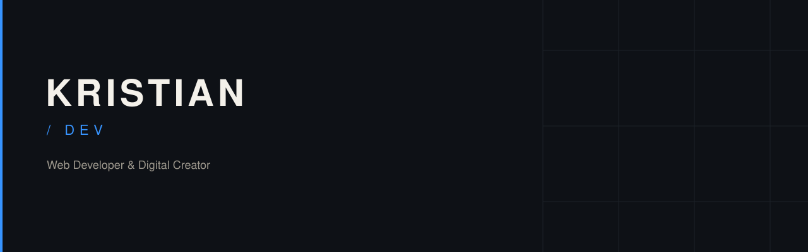

  

## Technologies

I work with these technologies. They are not certifications or a claim of expert-level proficiency.

**Frontend**

  

**Backend**

  
  

**Other technologies**

  
  

**AI tools**

  
  
  

---

## About

I am interested in web development, digital products, software development, automation, AI integration, IT systems, and operating systems.

I learn by building real projects: websites, applications, and tools that are actually useful.

## Currently working on

- Building independent digital products
- Improving my full-stack development skills
- Developing web applications
- Exploring AI-powered development workflows
- Learning more about IT systems and infrastructure
